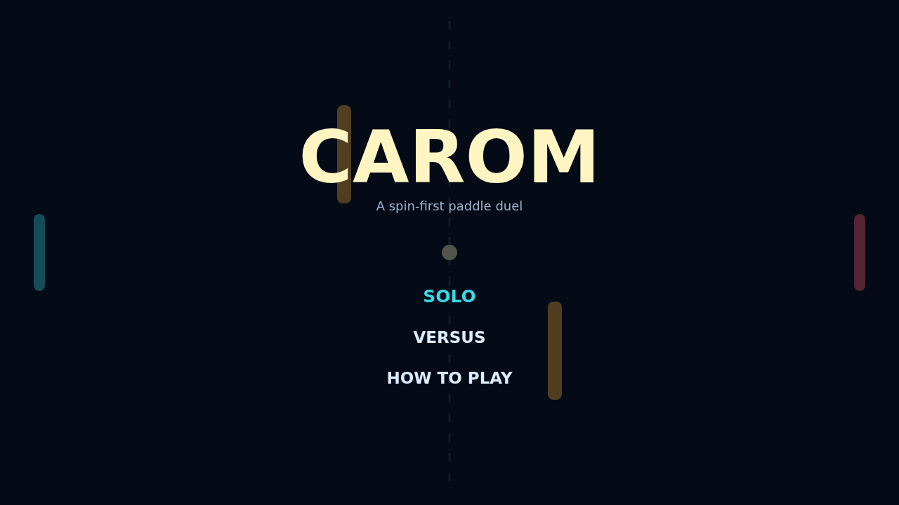

# Carom

Carom is a bright, quick duel on a midnight field. Two paddles face off across a dotted net, with amber gates turning every rally into a geometry problem.

The opening serve starts simply, then each return gets faster. Find the far edge of your paddle for sharp angles, use the walls for a surprise bank, and keep the ball away from the open goal behind you.

The signature move is spin. Sweep your paddle up or down at contact and the ball curls through the next stretch of flight, letting a familiar exchange become a route around an obstacle.

Solo puts you against a reactive defender; Versus is a compact local match for two people at one keyboard. First to eleven, win by two.

